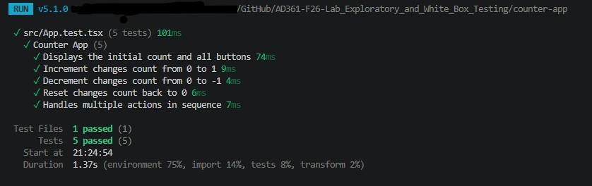
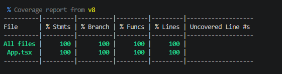

## Part 1: Exploratory Testing

**Testing Charter**: Investigate how the counter responds to increment, decrement, and reset actions. 

| Action | Expected Result | Actual Result | Pass or Fail |
| --- | --- | --- | --- |
| Click Increment once | Count increases from 0 to 1 | Count displayed 1 | Passed |
| Click Decrement once from 0 | Count decreases from 0 to -1 | Count displayed -1 | Passed |
| Click Increment three times from 0 | Count increases to 3 | Count displayed 3 | Passed |
| Click Reset after changing the count | Count returns to 0 | Count displayed 0 | Passed |
| Click Increment after resetting | Count increases from 0 to 1 | Count displayed 1 | Passed |

## Step 2: Examine the Source Code

### Starting Value

The counter starts at `0`, initialized using `useState(0)`.

### Statements That Change the Count

| Statement | User Action | Result |
| --- | --- | --- |
| `setCount(count + 1)` | Click Increment | Increases the count by 1 |
| `setCount(count - 1)` | Click Decrement | Decreases the count by 1 |
| `setCount(0)` | Click Reset | Sets the count back to 0 |

### Branches and Loops

There are no conditional branches (`if`, `else`, or `switch`) or loops (`for` or `while`) in this component.

Branch coverage and loop coverage do not apply to this component because it has no explicit branches or loops to test.

## Step 3–6: Automated Testing

*Tests will be written in `counter-app/src/App.test.tsx`.*

## Step 7: Test Results

The automated test suite was executed using Vitest and React Testing Library.

All five tests passed, covering the initial state, increment, decrement, reset, and a sequence of multiple actions.

## Step 8: Code Coverage

| Coverage Type | Percentage |
| --- | --- |
| Statements | 100% |
| Branches | 100% |
| Functions | 100% |
| Lines | 100% |

### Coverage Analysis

The tests executed all three statements that change the counter's state: increment, decrement, and reset. The tests also verified the initial state and a sequence of actions.

No statements remained untested, resulting in 100% statement and line coverage. Since the component does not contain any conditional branches or loops, which explains why branch coverage is reported as 100%.

Although the tests achieved 100% coverage, this does not automatically mean the component is free of bugs. Code coverage only measures which parts of the code were executed, not whether every possible behavior was tested.

## Step 9: Comparing Exploratory and White Box Testing

During exploratory testing, I tried different combinations of button clicks to see how the counter responded. This included incrementing multiple times, decrementing, and resetting the count.

After reviewing the source code, I could see how each button updated the count. This helped me understand what needed to be tested and why it was important to change the count before testing Reset. I also made sure to check the displayed value after each action rather than just assuming the buttons worked.

One limitation of exploratory testing is that it's easy to miss something when testing without knowing how the application works internally. White-box testing provides more insight into the code, but even achieving 100% coverage doesn't guarantee that every possible issue has been found.